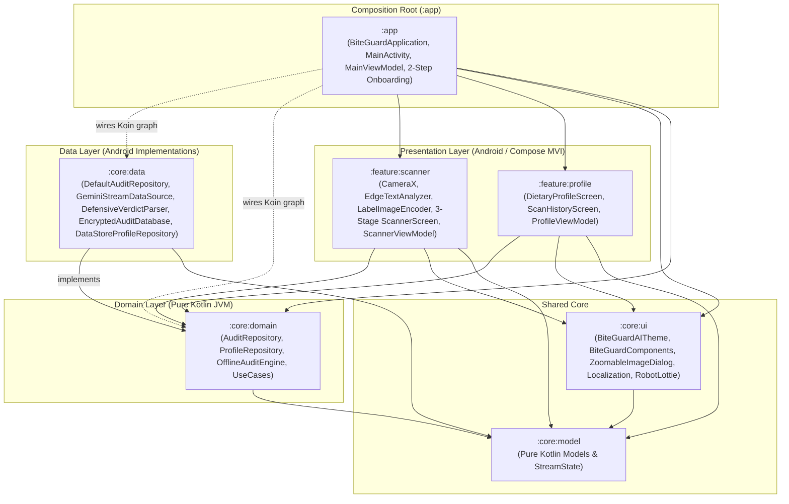
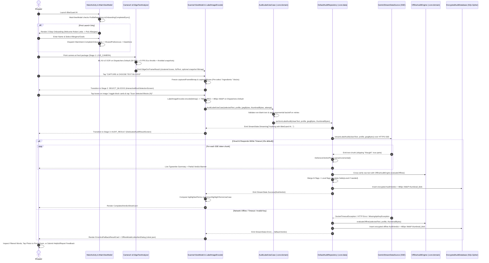

# 🛡️ BiteGuard AI — Comprehensive Technical Documentation

> [!NOTE]
> **Document Scope**: This technical specification details the complete technology stack, Clean Architecture boundaries and trade-offs, dynamic and adaptive feature inventory, and a step-by-step end-to-end execution walkthrough of **BiteGuard AI** from cold start to encrypted persistence.

---

## 1. Executive Summary & System Overview

**BiteGuard AI** is a privacy-first, multimodal Android decision-support application (`minSdk = 30`, `targetSdk = 37`) engineered to help shoppers with severe food allergies and clinical/lifestyle dietary goals audit packaged food labels in real time.

Food labels frequently obscure allergens behind chemical or industrial synonyms (e.g., *Arachis Oil* for peanuts, *Sodium Caseinate* or *Lactalbumin* for dairy, *Albumin* for eggs, *Disodium Inosinate* for high-sodium flavor enhancers). At the same time, grocery store aisles often suffer from poor cellular reception. BiteGuard AI solves both problems through a **Three-Tier Hybrid Intelligence Architecture**:

1. **Tier 1 — On-Device Edge OCR (CameraX + Google ML Kit Text Recognition v2 / LiteRT)**: Runs real-time paragraph block detection on-device with thermal throttling protection (`30 FPS` active -> `5 FPS` idle eco mode) and throttled snapshot bitmap capture.
2. **Tier 2 — Cloud Multimodal Streaming Reasoning (Google Gemini 3.8 Flash SSE)**: Evaluates user-selected OCR blocks plus a compressed `768px` JPEG package snapshot over Server-Sent Events (`streamGenerateContent?alt=sse`), streaming progressive token-by-token verdicts (`SAFE`, `CAUTION`, `DANGER`).
3. **Tier 3 — Deterministic On-Device Chemical-Derivative Engine (`OfflineAuditEngine` / `RuleBasedOfflineAuditEngine`)**: Pure Kotlin domain engine with precompiled regex rules that cross-verifies every cloud response so critical allergens are never missed by LLM hallucination, and automatically takes over 100% offline when network connectivity is unavailable or times out.

---

## 2. Complete Technology Stack & Dependency Matrix

| Layer / Domain | Technology / Library | Version | Key Role in BiteGuard AI |
| :--- | :--- | :--- | :--- |
| **Language & Build** | Kotlin / Android Gradle Plugin (AGP) | `2.2.10` / `9.5.2` | Multi-module Kotlin codebase (2 pure JVM + 5 Android modules) with Compose Compiler & Kotlinx Serialization. |
| **UI Toolkit** | Jetpack Compose BOM & Material 3 | `2026.02.01` | Declarative UI, adaptive M3 color tokens, `ModalBottomSheet`, `AnimatedContent`, and draw-phase `Canvas` animations. |
| **Vector Animation** | Airbnb Lottie Compose | `6.7.1` | Renders hardware-accelerated `res/raw/robot.json` Guardian Robot animations on Onboarding & Offline fallback dialogs. |
| **Camera Pipeline** | AndroidX CameraX (`core`, `camera2`, `lifecycle`, `view`) | `1.7.0` | Lifecycle-bound camera preview and non-blocking `ImageAnalysis.STRATEGY_KEEP_ONLY_LATEST` frame pipeline. |
| **On-Device Edge OCR** | Google ML Kit Text Recognition v2 | `16.0.1` | On-device TensorFlow Lite (LiteRT) text detection & paragraph clustering (`TextRecognizerOptions.DEFAULT_OPTIONS`). |
| **Cloud Multimodal AI** | Direct Gemini REST SSE (`v1beta`) | `gemini-3.8-flash` | Direct `HttpURLConnection` Server-Sent Events client with automatic fallback (`gemini-3.8-flash` -> `gemini-3.5-flash-lite` -> `gemini-2.5-flash`). |
| **Profile Persistence** | Jetpack DataStore (`datastore-preferences`) + `SharedPreferences` | `1.3.0` | Reactive `Flow<UserDietaryProfile>` persistence paired with a synchronous cold-start onboarding cache. |
| **Encrypted Database** | Zetetic SQLCipher Android + AndroidX SQLite KTX | `4.20.0` / `2.7.1` | 256-bit AES full-database encryption (`EncryptedAuditDatabase`) for scan history, in-memory `480px` WebP snapshots, and telemetry events. |
| **Hardware Cryptography** | Android Keystore (`AES/GCM/NoPadding`) | Platform API 30+ | Hardware-backed master key (`biteguard_db_master_key`) wrapping the 32-byte random SQLCipher database passphrase. |
| **Dependency Injection** | Koin (`koin-core`, `koin-android`, `koin-androidx-compose`) | `4.1.0` | Lightweight, reflection-free dependency graph wiring pure JVM domain UseCases, data implementations, and Compose `ViewModel`s. |
| **Concurrency & Streams** | Kotlinx Coroutines & Flow (`StateFlow`, `channelFlow`) | `1.10.2` | Structured concurrency across `Dispatchers.Default` (CPU/OCR/Bitmap/Parser) and `Dispatchers.IO` (Network/Disk/DB). |
| **JSON Parsing** | Kotlinx Serialization JSON | `1.9.0` | Lenient, fault-tolerant parsing of SSE chunks and truncated LLM `FLAGS_JSON` arrays. |
| **Testing & Verification** | JUnit 4, Kotlinx Coroutines Test, CashApp Turbine, Koin Test, Compose UI Test | `4.13.2` / `1.2.1` | Pure-JVM domain tests, deterministic `StateFlow` pipeline & timeout fallback tests, DI graph verification, and Compose UI tests. |

---

## 3. Why This Architectural Approach Was Chosen (Design Rationales)

### 3.1 Multi-Module Clean Architecture (Dependency Inversion)
The project is partitioned into **7 Gradle sub-projects** following Clean Architecture's Dependency Rule—high-level business rules (`:core:domain`) and presentation features (`:feature:*`) never depend on concrete storage or networking implementations (`:core:data`):



* **Why `:core:model` and `:core:domain` are Pure Kotlin JVM (`kotlin-jvm`)**: Keeping entities ([BiteGuardModels.kt](file:///C:/Users/akmal/AndroidStudioProjects/BiteGuardAI/core/model/src/main/kotlin/com/biteguard/core/model/BiteGuardModels.kt)), repository interfaces ([AuditRepository.kt](file:///C:/Users/akmal/AndroidStudioProjects/BiteGuardAI/core/domain/src/main/kotlin/com/biteguard/core/domain/repository/AuditRepository.kt), [ProfileRepository.kt](file:///C:/Users/akmal/AndroidStudioProjects/BiteGuardAI/core/domain/src/main/kotlin/com/biteguard/core/domain/repository/ProfileRepository.kt)), [OfflineAuditEngine.kt](file:///C:/Users/akmal/AndroidStudioProjects/BiteGuardAI/core/domain/src/main/kotlin/com/biteguard/core/domain/engine/OfflineAuditEngine.kt), and UseCases completely free of Android SDK classes (even `android.graphics.Bitmap`) guarantees instant JVM unit testing and prevents UI or storage details from leaking into business rules.
* **Why Feature Modules Do Not Depend on `:core:data`**: `:feature:scanner` and `:feature:profile` depend only on `:core:domain`, `:core:ui`, and `:core:model` in production source sets. Swapping SQLCipher, DataStore, or the Gemini HTTP client inside `:core:data` never forces feature modules to change or recompile.
* **Why Feature Isolation (`:feature:scanner` vs. `:feature:profile`)**: CameraX and ML Kit dependencies are heavy and hardware-specific; isolating them inside `:feature:scanner` keeps `:feature:profile` and `:core:ui` lightweight and fast to build.
* **Why `MainViewModel` Replaces Direct Repository Calls in `MainActivity`**: [MainViewModel.kt](file:///C:/Users/akmal/AndroidStudioProjects/BiteGuardAI/app/src/main/java/com/example/biteguardai/MainViewModel.kt) owns onboarding, locale, and high-contrast state mutations via `MainIntent`, keeping [MainActivity.kt](file:///C:/Users/akmal/AndroidStudioProjects/BiteGuardAI/app/src/main/java/com/example/biteguardai/MainActivity.kt) purely declarative.

---

### 3.2 Why Direct REST SSE Instead of the Archived `generativeai:0.9.0` SDK
During integration with Google AI Studio's latest API standards, the legacy `com.google.ai.client.generativeai:0.9.0` client wrapper (now removed from the project) exhibited three critical limitations:
1. **New `AQ.` Authentication Key Format**: Google AI Studio introduced `AQ.` prefixed keys alongside legacy `AIza` keys.
2. **Model Deprecation & Schema Evolution**: Newer models such as `gemini-3.8-flash` emit `"thought": true` reasoning parts and extended `usageMetadata` fields that crash the old 0.9.0 SDK with `MissingFieldException` / `SerializationException`.
3. **Opaque Exceptions**: The old SDK wrapped HTTP errors in generic exceptions, hiding the underlying 400/404 JSON payload.

**Our Solution ([GeminiStreamDataSource](file:///C:/Users/akmal/AndroidStudioProjects/BiteGuardAI/core/data/src/main/java/com/biteguard/core/data/ai/GeminiAuditService.kt))**:
* Connects directly to `https://generativelanguage.googleapis.com/v1beta/models/{model}:streamGenerateContent?alt=sse` over `HttpURLConnection` on `Dispatchers.IO`.
* Sends `x-goog-api-key` supporting both `AQ.` and `AIza` keys.
* Implements an **Automatic Model Fallback Chain** (`gemini-3.8-flash` -> `gemini-3.5-flash-lite` -> `gemini-2.5-flash`) if a model returns HTTP `404 NOT_FOUND` or times out before emitting its first chunk.
* Strips internal `"thought": true` reasoning tokens in `extractTextFromSseChunk` so only clean user-facing verdict text is streamed to the UI.
* Receives pre-compressed `768px` JPEG bytes (`LabelImageEncoder` in `:feature:scanner`) and encodes them via `java.util.Base64`, keeping `GeminiStreamDataSource` free of `android.graphics.Bitmap`.

---

### 3.3 Why the 3-Stage Scanning Flow (`Capture -> Choose Blocks -> Audit Result`)
In early iterations, live OCR bounding boxes were drawn directly over the live camera preview and audited all detected text at once. That caused two UX issues:
1. **Visual Jitter**: As the user's hand moved slightly, OCR bounding boxes shifted continuously on every frame, making it difficult to lock onto the exact ingredient paragraph.
2. **Irrelevant Package Noise**: Food packages contain marketing slogans, nutrition tables, manufacturer addresses, and barcodes alongside the actual ingredient list.

**Our Solution ([ScannerScreen.kt](file:///C:/Users/akmal/AndroidStudioProjects/BiteGuardAI/feature/scanner/src/main/java/com/biteguard/feature/scanner/ScannerScreen.kt) & [ScannerViewModel.kt](file:///C:/Users/akmal/AndroidStudioProjects/BiteGuardAI/feature/scanner/src/main/java/com/biteguard/feature/scanner/ScannerViewModel.kt))**:
* **Stage 1 (`LIVE_CAMERA`)**: Shows a calm, uncluttered camera preview with only a central focus reticle and a top status pill (`CompactScannerTopHud`).
* **Stage 2 (`SELECT_BLOCKS` — `InteractiveBlockSelectionScreen`)**: When the user taps the capture button, the current frame bitmap and detected OCR blocks are **frozen** (`isSelectingBlocks = true`). Incoming camera frames are ignored while selecting. Blocks containing structural keywords (`Ingredients:`, `Contains:`, `Komposisi`) are automatically pre-selected, and the user can tap bounding boxes directly on the frozen photo or toggle checkboxes in the vertical card list before tapping **"Scan Selected Blocks (N)"**.
* **Stage 3 (`AUDIT_RESULT` — `DedicatedAuditResultScreen`)**: Transitions to a dedicated result screen displaying the verdict banner, click-to-zoom package snapshot, separated **Filtered Words & Flagged Ingredients** card (using `state.highlightedTerms` computed via `ExtractHighlightTermsUseCase`), and the Offline Guardian Robot `AlertDialog` if the cloud model is unreachable.

---

### 3.4 Why Dual-Layer Persistence (`SharedPreferences` + `DataStore` + `SQLCipher`)
1. **Zero-Flash One-Time Onboarding (`DataStoreProfileRepository`)**:
   * Jetpack `DataStore<Preferences>` is asynchronous (`Dispatchers.IO`). If the app defaults `isOnboarded = false` while waiting ~20–40ms for DataStore's first emission, the Welcome Screen flashes on every cold start.
   * By mirroring the boolean onboarding flag in a synchronous `SharedPreferences` cache (`isOnboardingCompletedSync()`) read when `MainViewModel` initializes alongside reactive `DataStore<Preferences>`, the app knows on **Frame 1** whether the user has already onboarded—guaranteeing the Welcome Screen is shown **strictly once**.
2. **Zero-Cloud Encrypted Audit Log (`EncryptedAuditDatabase`)**:
   * Dietary profiles and scanned food history represent sensitive personal health data.
   * [EncryptedAuditDatabase](file:///C:/Users/akmal/AndroidStudioProjects/BiteGuardAI/core/data/src/main/java/com/biteguard/core/data/db/EncryptedAuditDatabase.kt) generates a 32-byte cryptographically random passphrase, encrypts it using an Android Keystore hardware-backed `AES/GCM/NoPadding` master key (`biteguard_db_master_key`), and passes it to **SQLCipher (`net.zetetic:sqlcipher-android`)**.
   * Captured package photos are downsampled **exclusively in memory** (`480px` WebP at 78% quality via `LabelImageEncoder`) and stored as encrypted `thumbnail_blob` `BLOB`s inside SQLCipher—never written to unencrypted disk files.

---

## 4. Dynamic & Adaptive Features Inventory

| Feature Category | Dynamic Behavior & Implementation Details | Primary Source Files |
| :--- | :--- | :--- |
| **1. One-Time Adaptive 2-Step Onboarding** | • **Step 1 (`WelcomeNameStep`)**: Vertical layout (`Welcome Message` -> `robot.json` Lottie -> `"Ready to make every bite safer and healthier?"` + Language selector + Name input).<br>• **Step 2 (`PickAllergiesStep`)**: Material 3 `FilterChip` grid for 9 FDA allergens + collapsible `BiteGuardAccordion` for 6 health goals.<br>• **Responsive Sizing**: Uses `BoxWithConstraints` to scale Lottie size (`110dp`–`200dp`) and typography across compact phones, tablets, and landscape orientations. | [OnboardingScreens.kt](file:///C:/Users/akmal/AndroidStudioProjects/BiteGuardAI/app/src/main/java/com/example/biteguardai/ui/onboarding/OnboardingScreens.kt)<br>[MainViewModel.kt](file:///C:/Users/akmal/AndroidStudioProjects/BiteGuardAI/app/src/main/java/com/example/biteguardai/MainViewModel.kt) |
| **2. Adaptive Theme & Ultra High-Contrast Mode** | • Automatically adapts all surfaces, text, fields, borders, and draw-phase ambient background glows (`RadialModernAnimatedBackground`) to system Light Mode, Dark Mode, and **WCAG 2.1 AAA Ultra High-Contrast Mode**.<br>• One-tap accessibility toggle in `TopAppBar` and Profile screen. | [Theme.kt](file:///C:/Users/akmal/AndroidStudioProjects/BiteGuardAI/core/ui/src/main/java/com/example/biteguardai/ui/theme/Theme.kt)<br>[Color.kt](file:///C:/Users/akmal/AndroidStudioProjects/BiteGuardAI/core/ui/src/main/java/com/example/biteguardai/ui/theme/Color.kt) |
| **3. Eco Thermal-Throttled Edge OCR** | • Analyzes camera frames on `Dispatchers.Default` via ML Kit Text Recognition v2.<br>• Computes text hash signature + bounding-box centroid delta; if stationary for `> 5,000ms`, automatically throttles analysis from `30 FPS` (`33ms`) to `5 FPS` (`200ms`), throttles `imageProxy.toBitmap()` snapshot decoding (`1,000ms` / `350ms` on text change), caches cluster bounds via `ClusterAccumulator`, and closes every `ImageProxy` in `finally`. | [EdgeTextAnalyzer.kt](file:///C:/Users/akmal/AndroidStudioProjects/BiteGuardAI/feature/scanner/src/main/java/com/biteguard/feature/scanner/EdgeTextAnalyzer.kt) |
| **4. Interactive Frozen Block Picker** | • Freezes the camera bitmap and OCR bounding boxes on capture.<br>• Pre-selects blocks matching `"Ingredients:"`, `"Contains:"`, `"May contain:"`, or `"Komposisi"`.<br>• Users can tap boxes directly on the image canvas (`detectTapGestures`) or toggle vertical M3 block cards, use **Select All / Clear All**, or open **Edit Text**. | [ScannerScreen.kt](file:///C:/Users/akmal/AndroidStudioProjects/BiteGuardAI/feature/scanner/src/main/java/com/biteguard/feature/scanner/ScannerScreen.kt)<br>[ScannerViewModel.kt](file:///C:/Users/akmal/AndroidStudioProjects/BiteGuardAI/feature/scanner/src/main/java/com/biteguard/feature/scanner/ScannerViewModel.kt) |
| **5. Real-Time SSE Streaming & Defensive Parser** | • Streams incremental `VERDICT:` and `SUMMARY:` tokens into `StreamingTypewriterCard` with live cursor animation (`▌`).<br>• `DefensiveVerdictParser` uses precompiled regexes to sanitize markdown wrappers and recover truncated `FLAGS_JSON` arrays if a stream terminates early. | [GeminiAuditService.kt](file:///C:/Users/akmal/AndroidStudioProjects/BiteGuardAI/core/data/src/main/java/com/biteguard/core/data/ai/GeminiAuditService.kt)<br>[AuditRepository.kt](file:///C:/Users/akmal/AndroidStudioProjects/BiteGuardAI/core/data/src/main/java/com/biteguard/core/data/audit/AuditRepository.kt) |
| **6. Offline Robot Guardian Alert & Domain Rule Engine** | • If Cloud AI times out, is offline, or lacks an API key, `RuleBasedOfflineAuditEngine` (`:core:domain`) audits the text against precompiled regex dictionaries of chemical allergen synonyms & dietary conflict terms on-device.<br>• Displays `OfflineModelLottieAlertDialog` with `robot.json` and an immediate local safety verdict. | [OfflineAuditEngine.kt](file:///C:/Users/akmal/AndroidStudioProjects/BiteGuardAI/core/domain/src/main/kotlin/com/biteguard/core/domain/engine/OfflineAuditEngine.kt)<br>[BiteGuardComponents.kt](file:///C:/Users/akmal/AndroidStudioProjects/BiteGuardAI/core/ui/src/main/java/com/biteguard/core/ui/components/BiteGuardComponents.kt) |
| **7. Streamlined Scan History, Bulk Delete & Click-to-Zoom** | • **75% Scrollable Viewport**: Compact search bar + horizontally scrolling safety filter chips (with memoized counts) dedicate ~75% of screen height to the scrollable history list.<br>• **Latest Scan Badge**: Marks the newest unfiltered scan card with a `"LATEST"` pill.<br>• **Long-Press Multi-Select & Bulk Deletion**: Long-pressing any scan card activates multi-select mode with a contextual action bar (`${count} selected`, Select All, Bulk Delete confirmation) and checkboxes.<br>• **Pinch-to-Zoom**: Tapping any package photo opens `ZoomableImageDialog` (1×–5× pinch-to-zoom, pan, and double-tap zoom). | [ProfileAndHistoryScreens.kt](file:///C:/Users/akmal/AndroidStudioProjects/BiteGuardAI/feature/profile/src/main/java/com/biteguard/feature/profile/ProfileAndHistoryScreens.kt)<br>[ProfileViewModel.kt](file:///C:/Users/akmal/AndroidStudioProjects/BiteGuardAI/feature/profile/src/main/java/com/biteguard/feature/profile/ProfileViewModel.kt)<br>[FilterScanHistoryUseCase.kt](file:///C:/Users/akmal/AndroidStudioProjects/BiteGuardAI/core/domain/src/main/kotlin/com/biteguard/core/domain/usecase/FilterScanHistoryUseCase.kt) |
| **8. Material 3 Accordions for Information Density** | • Reusable `BiteGuardAccordion` collapses long lists (Health Goals, Common Hidden Derivatives Reference Guide, Overflow Flagged Ingredients, and Highlighted Raw OCR Text) so no screen feels crowded. | [BiteGuardComponents.kt](file:///C:/Users/akmal/AndroidStudioProjects/BiteGuardAI/core/ui/src/main/java/com/biteguard/core/ui/components/BiteGuardComponents.kt) |

---

## 5. Step-by-Step End-to-End Execution Walkthrough



### Step 1: Application Bootstrap & Koin Dependency Graph (`BiteGuardApplication.kt`)
1. When the Android OS starts the process, [BiteGuardApplication.onCreate](file:///C:/Users/akmal/AndroidStudioProjects/BiteGuardAI/app/src/main/java/com/example/biteguardai/BiteGuardApplication.kt) initializes Koin with `allBiteGuardModules`:
   - `coreDomainModule` ([CoreDomainModule.kt](file:///C:/Users/akmal/AndroidStudioProjects/BiteGuardAI/core/domain/src/main/kotlin/com/biteguard/core/domain/di/CoreDomainModule.kt)): registers `OfflineAuditEngine` (`RuleBasedOfflineAuditEngine`) and factories for `AuditLabelUseCase`, `EvaluateOfflineLabelUseCase`, `SubmitAuditFeedbackUseCase`, `ExtractHighlightTermsUseCase`, and `FilterScanHistoryUseCase`.
   - `coreDataModule` ([CoreDataModule.kt](file:///C:/Users/akmal/AndroidStudioProjects/BiteGuardAI/core/data/src/main/java/com/biteguard/core/data/di/CoreDataModule.kt)): binds `:core:domain` repository interfaces to concrete data implementations (`DataStoreProfileRepository`, `EncryptedAuditDatabase`, `GeminiStreamDataSource`, `DefaultAuditRepository`).
   - `featureScannerModule` ([FeatureScannerModule.kt](file:///C:/Users/akmal/AndroidStudioProjects/BiteGuardAI/feature/scanner/src/main/java/com/biteguard/feature/scanner/di/FeatureScannerModule.kt)): registers `ScannerViewModel`.
   - `featureProfileModule` ([FeatureProfileModule.kt](file:///C:/Users/akmal/AndroidStudioProjects/BiteGuardAI/feature/profile/src/main/java/com/biteguard/feature/profile/di/FeatureProfileModule.kt)): registers `ProfileViewModel`.
   - `appModule` ([BiteGuardApplication.kt](file:///C:/Users/akmal/AndroidStudioProjects/BiteGuardAI/app/src/main/java/com/example/biteguardai/BiteGuardApplication.kt)): registers `MainViewModel`.

### Step 2: One-Time Onboarding Check & Adaptive Welcome Flow (`MainActivity.kt`, `MainViewModel.kt`, `OnboardingScreens.kt`)
1. [MainViewModel](file:///C:/Users/akmal/AndroidStudioProjects/BiteGuardAI/app/src/main/java/com/example/biteguardai/MainViewModel.kt) reads `profileRepository.isOnboardingCompletedSync()` for its initial `StateFlow` value so [MainActivity](file:///C:/Users/akmal/AndroidStudioProjects/BiteGuardAI/app/src/main/java/com/example/biteguardai/MainActivity.kt) knows on Frame 1 whether onboarding is complete.
2. **If `false` (First-ever app launch)**:
   - Renders [BiteGuardOnboardingFlow](file:///C:/Users/akmal/AndroidStudioProjects/BiteGuardAI/app/src/main/java/com/example/biteguardai/ui/onboarding/OnboardingScreens.kt) wrapped in [RadialModernAnimatedBackground](file:///C:/Users/akmal/AndroidStudioProjects/BiteGuardAI/core/ui/src/main/java/com/biteguard/core/ui/components/BiteGuardComponents.kt).
   - **Screen 1 (`WelcomeNameStep`)**: Displays the welcome header, animated Guardian Robot (`RobotLottieAnimation` using `res/raw/robot.json`), prompt *"Ready to make every bite safer and healthier?"*, language chips, and name input.
   - **Screen 2 (`PickAllergiesStep`)**: Allows picking any of the 9 major allergens and expanding the optional Health Goals accordion (6 goals).
   - Completing onboarding dispatches `MainIntent.CompleteOnboarding(userName, allergens, goals)`, writing synchronously to `SharedPreferences` and asynchronously to `DataStore<Preferences>`.
3. **If `true` (All subsequent launches)**:
   - Immediately renders `BiteGuardMainScaffold` without flashing the onboarding screen.

### Step 3: Stage 1 — Live CameraX Preview & Eco-Throttled ML Kit OCR (`EdgeTextAnalyzer.kt`)
1. On the **Scan Label** tab (`ScannerStage.LIVE_CAMERA`), [CameraXEdgePreviewWithOverlays](file:///C:/Users/akmal/AndroidStudioProjects/BiteGuardAI/feature/scanner/src/main/java/com/biteguard/feature/scanner/ScannerScreen.kt) binds a CameraX `Preview` and `ImageAnalysis` use case (`STRATEGY_KEEP_ONLY_LATEST`) to the lifecycle owner, receiving only `isReadyToScan: Boolean` so live OCR frames don't unnecessarily recompose the CameraX host.
2. If camera permission is not yet granted, `CameraPermissionFallbackContent` displays a high-contrast Material 3 card allowing the user to grant permission, run a demo sample label, or paste ingredients manually.
3. For each camera frame, [EdgeTextAnalyzer.analyze](file:///C:/Users/akmal/AndroidStudioProjects/BiteGuardAI/feature/scanner/src/main/java/com/biteguard/feature/scanner/EdgeTextAnalyzer.kt):
   - Enforces the frame-rate gate (`33ms` active / `200ms` when stationary for `> 5s`) and an `AtomicBoolean` backpressure guard.
   - Runs `TextRecognition.getClient(TextRecognizerOptions.DEFAULT_OPTIONS).process(inputImage)` on `Dispatchers.Default`.
   - **Spatial Paragraph Clustering**: Executes `EdgeTextAnalyzer.clusterTextBoxes` using `ClusterAccumulator` (cached cluster bounding `Rect`s) to merge fragmented lines into cohesive paragraph blocks and filter stray punctuation.
   - **Throttled Snapshot Decoding**: Only decodes `imageProxy.toBitmap()` when text is present and either no snapshot exists yet, text changed (`>= 350ms`), or `>= 1,000ms` elapsed—eliminating 30 FPS full-resolution bitmap churn—and always closes `imageProxy` in `finally`.
   - Dispatches `ScannerIntent.OnEdgeFrameAnalyzed(result)` to `ScannerViewModel`.

### Step 4: Stage 2 — Freezing the Frame & Choosing Text Blocks (`InteractiveBlockSelectionScreen`)
1. When the shopper taps **"READY — CAPTURE & PICK BLOCKS"** (or **"CAPTURE & CHOOSE TEXT BLOCKS"**), `ScannerViewModel` processes `ScannerIntent.CaptureFrameForBlockSelection`:
   - Freezes `capturedFrameBitmap` and `capturedBoxes` into `BlockSelectionSession(isActive = true, ...)`.
   - Pre-selects any blocks where `containsIngredientKeyword == true` (or all blocks if none explicitly contain a header keyword).
2. `ScannerScreen` transitions via `AnimatedContent` to `ScannerStage.SELECT_BLOCKS` (`InteractiveBlockSelectionScreen`):
   - Renders the frozen package photo at the top with interactive bounding boxes drawn on a `Canvas`. Tapping inside any box on the photo toggles its selection.
   - Renders a vertical `LazyColumn` of detected text block cards below with checkboxes and `"INGREDIENTS"` badges, plus **"Select All / Clear All"**, **"Edit Text"**, and **"Retake Photo"** buttons.
3. When the shopper taps **"Scan Selected Blocks (N)"**, `ScannerViewModel` joins the selected blocks in reading order, encodes the frozen bitmap via [LabelImageEncoder.kt](file:///C:/Users/akmal/AndroidStudioProjects/BiteGuardAI/feature/scanner/src/main/java/com/biteguard/feature/scanner/LabelImageEncoder.kt) on `Dispatchers.Default`, and invokes [AuditLabelUseCase.kt](file:///C:/Users/akmal/AndroidStudioProjects/BiteGuardAI/core/domain/src/main/kotlin/com/biteguard/core/domain/usecase/AuditLabelUseCase.kt).

### Step 5: Stage 3 — Multimodal AI Streaming, Cross-Verification & Offline Fallback
1. `ScannerScreen` transitions to `ScannerStage.AUDIT_RESULT` (`DedicatedAuditResultScreen`).
2. [AuditLabelUseCase](file:///C:/Users/akmal/AndroidStudioProjects/BiteGuardAI/core/domain/src/main/kotlin/com/biteguard/core/domain/usecase/AuditLabelUseCase.kt) validates non-blank text (`NO_TEXT_DETECTED`), applies exponential retry backoff when `retryAttempt > 0`, and delegates to [DefaultAuditRepository.performLabelAudit](file:///C:/Users/akmal/AndroidStudioProjects/BiteGuardAI/core/data/src/main/java/com/biteguard/core/data/audit/AuditRepository.kt).
3. `DefaultAuditRepository`:
   - Emits `StreamState.Streaming` (`"Auditing with BiteGuard AI..."`).
   - Launches [GeminiStreamDataSource.streamLabelAudit](file:///C:/Users/akmal/AndroidStudioProjects/BiteGuardAI/core/data/src/main/java/com/biteguard/core/data/ai/GeminiAuditService.kt) inside a `Channel` producer and enforces `withTimeout(firstTokenTimeoutMs)` (`15,000ms` default in production).
4. **Live Token Streaming**:
   - As SSE `data:` lines arrive from `gemini-3.8-flash`, `DefensiveVerdictParser.parseIncremental` extracts the partial `SafetyLevel` and summary on `Dispatchers.Default` using precompiled regexes.
   - `StreamingTypewriterCard` reveals the summary character-by-character with a typewriter cursor (`▌`).
5. **Hybrid Safety Cross-Verification**:
   - When the stream finishes, `DefaultAuditRepository` runs `DefensiveVerdictParser.parseFinal` and `offlineAuditEngine.evaluateOffline` on `Dispatchers.Default`.
   - It merges `flaggedIngredients` from both engines and resolves the final `SafetyLevel` conservatively (if either Gemini or the local chemical-derivative engine flags a `DANGER` allergen, the final verdict is `DANGER`).
6. **Resilient Offline Fallback**:
   - If the device has no internet, `GEMINI_API_KEY` is missing/invalid, or the socket times out, `DefaultAuditRepository` catches the failure, runs `offlineAuditEngine.evaluateOffline`, saves the fallback verdict to `EncryptedAuditDatabase`, and emits `StreamState.Error(..., fallbackVerdict = fallbackVerdict)`.
   - `DedicatedAuditResultScreen` automatically displays [OfflineModelLottieAlertDialog](file:///C:/Users/akmal/AndroidStudioProjects/BiteGuardAI/core/ui/src/main/java/com/biteguard/core/ui/components/BiteGuardComponents.kt) featuring the animated Guardian Robot (`robot.json`), allowing the user to accept the on-device verdict with one tap or retry Cloud AI with exponential backoff.

### Step 6: Encrypted Audit Log, Click-to-Zoom & Telemetry Feedback (`ProfileAndHistoryScreens.kt`)
1. Every completed verdict (`AuditVerdict`) is persisted into the encrypted SQLCipher table `audit_verdicts` along with its `480px` WebP `thumbnail_blob`, `ttft_ms`, and `total_duration_ms`.
2. On the **Audit Log** tab ([ScanHistoryScreen](file:///C:/Users/akmal/AndroidStudioProjects/BiteGuardAI/feature/profile/src/main/java/com/biteguard/feature/profile/ProfileAndHistoryScreens.kt)):
   - **Latest Badge**: Highlights the most recent scan at the top of the unfiltered list with a `"LATEST"` badge.
   - **Click-to-Zoom (`ClickableCapturedImageCard` & `ZoomableImageDialog`)**: Tapping the package photo on the Audit Result screen, any history card thumbnail, or the detail bottom sheet opens a full-screen interactive zoom viewer supporting 1×–5× pinch-to-zoom, panning, and double-tap zoom.
   - **Search & Safety Filters**: Users can search across product names, summaries, and flagged ingredients or filter by `SAFE`, `CAUTION`, or `DANGER` via [FilterScanHistoryUseCase](file:///C:/Users/akmal/AndroidStudioProjects/BiteGuardAI/core/domain/src/main/kotlin/com/biteguard/core/domain/usecase/FilterScanHistoryUseCase.kt) on `Dispatchers.Default`.
   - **Accuracy Telemetry (`VerdictFeedbackRow`)**: Tapping **Helpful** or **Report** invokes [SubmitAuditFeedbackUseCase](file:///C:/Users/akmal/AndroidStudioProjects/BiteGuardAI/core/domain/src/main/kotlin/com/biteguard/core/domain/usecase/SubmitAuditFeedbackUseCase.kt), updating the verdict's feedback status and inserting an encrypted `TelemetryEvent` into the SQLCipher `telemetry_events` table.

---

## 6. Verification, Testing & Diagnostic Logging

### Automated Unit Test Suites
Run all unit tests across all pure-JVM and Android modules:
```bash
./gradlew testDebugUnitTest :core:domain:test :core:model:test assembleDebug
```
* [DomainUseCasesTest.kt](file:///C:/Users/akmal/AndroidStudioProjects/BiteGuardAI/core/domain/src/test/kotlin/com/biteguard/core/domain/DomainUseCasesTest.kt): Pure-JVM tests for `RuleBasedOfflineAuditEngine`, `ExtractHighlightTermsUseCase`, `FilterScanHistoryUseCase`, and `AuditLabelUseCase`.
* [AuditRepositoryTest.kt](file:///C:/Users/akmal/AndroidStudioProjects/BiteGuardAI/core/data/src/test/java/com/biteguard/core/data/AuditRepositoryTest.kt): Verifies streaming token accumulation, timeout fallback to `OfflineAuditEngine`, malformed LLM output recovery, and feedback telemetry queuing.
* [EdgeTextAnalyzerTest.kt](file:///C:/Users/akmal/AndroidStudioProjects/BiteGuardAI/feature/scanner/src/test/java/com/biteguard/feature/scanner/EdgeTextAnalyzerTest.kt): Verifies spatial paragraph clustering, column separation, same-line continuation, and micro-noise filtering.
* [ScannerViewModelTest.kt](file:///C:/Users/akmal/AndroidStudioProjects/BiteGuardAI/feature/scanner/src/test/java/com/biteguard/feature/scanner/ScannerViewModelTest.kt): Verifies all 6 core scanner use cases including real-time OCR `ReadyToScan` detection, streaming `DANGER` resolution, offline fallback acceptance, `NO_TEXT_DETECTED` error handling, telemetry feedback queuing, and the **3-Stage Block Selection** flow.
* [ProfileViewModelTest.kt](file:///C:/Users/akmal/AndroidStudioProjects/BiteGuardAI/feature/profile/src/test/java/com/biteguard/feature/profile/ProfileViewModelTest.kt): Verifies reactive allergen/goal persistence, multi-criteria history filtering, and multi-select bulk deletion.
* [KoinModuleVerificationTest.kt](file:///C:/Users/akmal/AndroidStudioProjects/BiteGuardAI/app/src/test/java/com/example/biteguardai/KoinModuleVerificationTest.kt): Verifies the complete Koin DI graph across `coreDomainModule`, `featureProfileModule`, `featureScannerModule`, and `appModule` (`MainViewModel`, `ProfileViewModel`, `ScannerViewModel`).

### Structured Logcat Tags (Debug Builds Only)
Filter Android Studio Logcat by **`package:mine tag:BiteGuardAI`** to monitor real-time pipeline execution:
* `BiteGuardAI_Gemini`: HTTP status codes, model fallback attempts (`gemini-3.8-flash` -> `gemini-3.5-flash-lite` -> `gemini-2.5-flash`), masked API key prefix check, and SSE chunk counts.
* `BiteGuardAI_AuditRepo`: First-token latency (`ttftMs`), total stream duration, hybrid safety cross-verification, and offline fallback triggers.
* `BiteGuardAI_ScannerVM`: User intents, block selection state transitions, and stream state logging (`BuildConfig.DEBUG` gated).
* `BiteGuardAI_EdgeOCR`: ML Kit frame processing latency and 5-second eco thermal throttling transitions.
