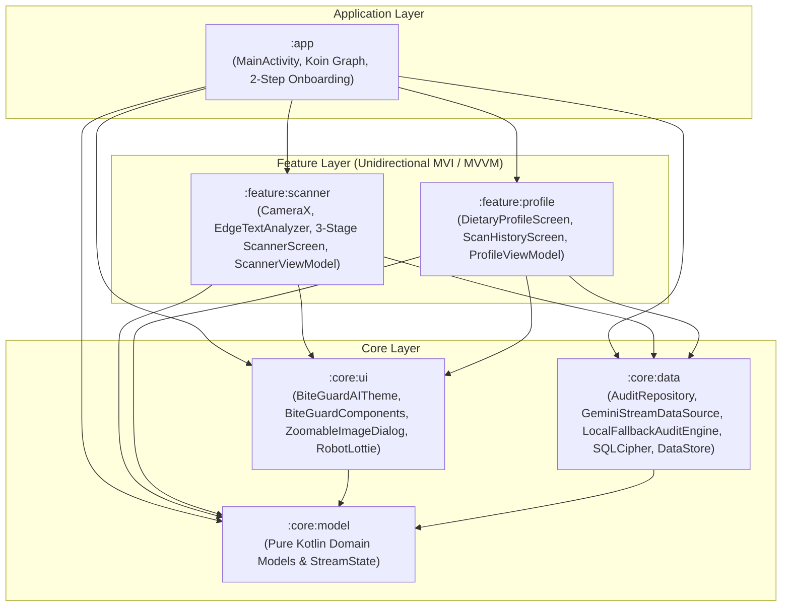
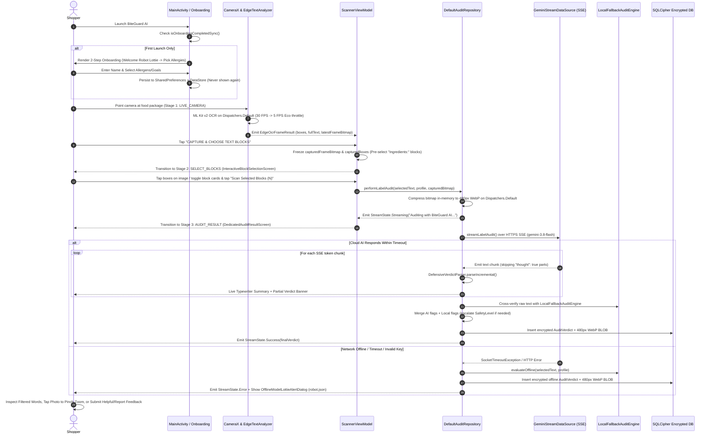

# 🛡️ BiteGuard AI — Comprehensive Technical Documentation

> [!NOTE]
> **Document Scope**: This technical specification details the complete technology stack, architectural trade-offs and design rationales, dynamic and adaptive feature inventory, and a step-by-step end-to-end execution walkthrough of **BiteGuard AI** from cold start to encrypted persistence.

---

## 1. Executive Summary & System Overview

**BiteGuard AI** is a privacy-first, multimodal Android decision-support application (`minSdk = 30`, `targetSdk = 35`) engineered to help shoppers with severe food allergies and clinical/lifestyle dietary goals audit packaged food labels in real time.

Food labels frequently obscure allergens behind chemical or industrial synonyms (e.g., *Arachis Oil* for peanuts, *Sodium Caseinate* or *Lactalbumin* for dairy, *Albumin* for eggs, *Disodium Inosinate* for high-sodium flavor enhancers). At the same time, grocery store aisles often suffer from poor cellular reception. BiteGuard AI solves both problems through a **Three-Tier Hybrid Intelligence Architecture**:

1. **Tier 1 — On-Device Edge OCR (CameraX + Google ML Kit Text Recognition v2 / LiteRT)**: Runs real-time paragraph block detection on-device with thermal throttling protection (`30 FPS` active -> `5 FPS` idle eco mode).
2. **Tier 2 — Cloud Multimodal Streaming Reasoning (Google Gemini 3.8 Flash SSE)**: Evaluates user-selected OCR blocks plus a compressed package snapshot over Server-Sent Events (`streamGenerateContent?alt=sse`), streaming progressive token-by-token verdicts (`SAFE`, `CAUTION`, `DANGER`).
3. **Tier 3 — Deterministic On-Device Chemical-Derivative Engine (`LocalFallbackAuditEngine`)**: Cross-verifies every cloud response so critical allergens are never missed by LLM hallucination, and automatically takes over 100% offline when network connectivity is unavailable or times out.

---

## 2. Complete Technology Stack & Dependency Matrix

| Layer / Domain | Technology / Library | Version | Key Role in BiteGuard AI |
| :--- | :--- | :--- | :--- |
| **Language & Build** | Kotlin / Android Gradle Plugin (AGP) | `2.2.10` / `9.5.2` | Multi-module Kotlin codebase with Compose Compiler plugin & Kotlinx Serialization. |
| **UI Toolkit** | Jetpack Compose BOM & Material 3 | `2026.02.01` | Declarative UI, adaptive M3 color tokens, `ModalBottomSheet`, `AnimatedContent`, and custom `Canvas` overlays. |
| **Vector Animation** | Airbnb Lottie Compose | `6.7.1` | Renders hardware-accelerated `res/raw/robot.json` Guardian Robot animations on Onboarding & Offline fallback dialogs. |
| **Camera Pipeline** | AndroidX CameraX (`core`, `camera2`, `lifecycle`, `view`) | `1.7.0` | Lifecycle-bound camera preview and non-blocking `ImageAnalysis.STRATEGY_KEEP_ONLY_LATEST` frame pipeline. |
| **On-Device Edge OCR** | Google ML Kit Text Recognition v2 | `16.0.1` | On-device TensorFlow Lite (LiteRT) text detection & paragraph clustering (`TextRecognizerOptions.DEFAULT_OPTIONS`). |
| **Cloud Multimodal AI** | Direct Gemini REST SSE (`v1beta`) | `gemini-3.8-flash` | Direct `HttpURLConnection` Server-Sent Events client with automatic fallback (`gemini-3.8-flash` -> `gemini-3.5-flash-lite` -> `gemini-2.5-flash`). |
| **Profile Persistence** | Jetpack DataStore (`datastore-preferences`) + `SharedPreferences` | `1.3.0` | Reactive `Flow<UserDietaryProfile>` persistence paired with a synchronous cold-start onboarding cache. |
| **Encrypted Database** | Zetetic SQLCipher Android + AndroidX SQLite KTX | `4.20.0` / `2.7.1` | 256-bit AES full-database encryption for scan history, in-memory `480px` WebP snapshots, and telemetry queues. |
| **Hardware Cryptography** | Android Keystore (`AES/GCM/NoPadding`) | Platform API 30+ | Hardware-backed master key wrapping the 32-byte random SQLCipher database passphrase. |
| **Dependency Injection** | Koin (`koin-android`, `koin-androidx-compose`) | `4.1.0` | Lightweight, reflection-free dependency graph wiring repositories, data sources, and Compose `ViewModel`s. |
| **Concurrency & Streams** | Kotlinx Coroutines & Flow (`StateFlow`, `channelFlow`) | `1.10.2` | Structured concurrency across `Dispatchers.Default` (CPU/OCR/Bitmap/Parser) and `Dispatchers.IO` (Network/Disk/DB). |
| **JSON Parsing** | Kotlinx Serialization JSON | `1.9.0` | Lenient, fault-tolerant parsing of SSE chunks and truncated LLM `FLAGS_JSON` arrays. |
| **Testing & Verification** | JUnit 4, Kotlinx Coroutines Test, CashApp Turbine, Compose UI Test | `4.13.2` / `1.2.1` | Deterministic unit tests for `StateFlow` pipelines, timeout fallbacks, and Compose accessibility/UI semantics. |

---

## 3. Why This Architectural Approach Was Chosen (Design Rationales)

### 3.1 Multi-Module Clean Architecture
The project is partitioned into **6 Gradle sub-projects** to enforce strict separation of concerns, fast incremental builds, and isolated JVM unit testing:



* **Why `:core:model` is Pure Kotlin (`kotlin-jvm`)**: Keeping domain entities ([UserDietaryProfile](file:///C:/Users/akmal/AndroidStudioProjects/BiteGuardAI/core/model/src/main/java/com/biteguard/core/model/BiteGuardModels.kt), [AuditVerdict](file:///C:/Users/akmal/AndroidStudioProjects/BiteGuardAI/core/model/src/main/java/com/biteguard/core/model/BiteGuardModels.kt), [Allergen](file:///C:/Users/akmal/AndroidStudioProjects/BiteGuardAI/core/model/src/main/java/com/biteguard/core/model/BiteGuardModels.kt), [HealthGoal](file:///C:/Users/akmal/AndroidStudioProjects/BiteGuardAI/core/model/src/main/java/com/biteguard/core/model/BiteGuardModels.kt), [StreamState](file:///C:/Users/akmal/AndroidStudioProjects/BiteGuardAI/core/model/src/main/java/com/biteguard/core/model/BiteGuardModels.kt)) free of Android framework dependencies ensures instant compilation and zero-mock testing across all modules.
* **Why Feature Isolation (`:feature:scanner` vs. `:feature:profile`)**: CameraX and ML Kit dependencies are heavy and hardware-specific; isolating them inside `:feature:scanner` prevents `:feature:profile` or `:core:ui` from recompiling when camera logic changes.

---

### 3.2 Why Direct REST SSE Instead of the Archived `generativeai:0.9.0` SDK
During integration with Google AI Studio's latest API standards, the legacy `com.google.ai.client.generativeai:0.9.0` client wrapper exhibited three critical limitations:
1. **New `AQ.` Authentication Key Format**: Google AI Studio introduced `AQ.` prefixed keys alongside legacy `AIza` keys.
2. **Model Deprecation & Schema Evolution**: Google deprecated `gemini-2.5-flash` for new users in favor of `gemini-3.8-flash`, which emits `"thought": true` reasoning parts and new `usageMetadata` fields that crash the old 0.9.0 SDK with `MissingFieldException` / `SerializationException`.
3. **Opaque Exceptions**: The old SDK wrapped HTTP errors in generic exceptions, hiding the underlying 400/404 JSON payload.

**Our Solution ([GeminiStreamDataSource](file:///C:/Users/akmal/AndroidStudioProjects/BiteGuardAI/core/data/src/main/java/com/biteguard/core/data/ai/GeminiAuditService.kt))**:
* Connects directly to `https://generativelanguage.googleapis.com/v1beta/models/{model}:streamGenerateContent?alt=sse` over `HttpURLConnection` on `Dispatchers.IO`.
* Sends `x-goog-api-key` supporting both `AQ.` and `AIza` keys.
* Implements an **Automatic Model Fallback Chain** (`gemini-3.8-flash` -> `gemini-3.5-flash-lite` -> `gemini-2.5-flash`) if a model returns HTTP `404 NOT_FOUND` or times out before emitting its first chunk.
* Strips internal `"thought": true` reasoning tokens in `extractTextFromSseChunk` so only clean user-facing verdict text is streamed to the UI.
* Downscales the multimodal package photo to `768px` (JPEG quality `72`) in memory so Base64 upload payloads are ~3× smaller and faster on mobile networks.

---

### 3.3 Why the 3-Stage Scanning Flow (`Capture -> Choose Blocks -> Audit Result`)
In early iterations, live OCR bounding boxes were drawn directly over the live camera preview and audited all detected text at once. That caused two UX issues:
1. **Visual Jitter**: As the user's hand moved slightly, OCR bounding boxes shifted continuously on every frame, making it difficult to lock onto the exact ingredient paragraph.
2. **Irrelevant Package Noise**: Food packages contain marketing slogans, nutrition tables, manufacturer addresses, and barcodes alongside the actual ingredient list.

**Our Solution ([ScannerScreen.kt](file:///C:/Users/akmal/AndroidStudioProjects/BiteGuardAI/feature/scanner/src/main/java/com/biteguard/feature/scanner/ScannerScreen.kt) & [ScannerViewModel.kt](file:///C:/Users/akmal/AndroidStudioProjects/BiteGuardAI/feature/scanner/src/main/java/com/biteguard/feature/scanner/ScannerViewModel.kt))**:
* **Stage 1 (`LIVE_CAMERA`)**: Shows a calm, uncluttered camera preview with only a central focus reticle and a top status pill (`CompactScannerTopHud`).
* **Stage 2 (`SELECT_BLOCKS` — `InteractiveBlockSelectionScreen`)**: When the user taps the capture button, the current frame bitmap and detected OCR blocks are **frozen** (`isSelectingBlocks = true`). Incoming camera frames are ignored while selecting. Blocks containing structural keywords (`Ingredients:`, `Contains:`, `Komposisi`) are automatically pre-selected, and the user can tap bounding boxes directly on the frozen photo or toggle checkboxes in the vertical card list before tapping **"Scan Selected Blocks (N)"**.
* **Stage 3 (`AUDIT_RESULT` — `DedicatedAuditResultScreen`)**: Transitions to a dedicated result screen displaying the verdict banner, click-to-zoom package snapshot, separated **Filtered Words & Flagged Ingredients** card, and the Offline Guardian Robot `AlertDialog` if the cloud model is unreachable.

---

### 3.4 Why Dual-Layer Persistence (`SharedPreferences` + `DataStore` + `SQLCipher`)
1. **Zero-Flash One-Time Onboarding (`DataStoreProfileRepository`)**:
   * Jetpack `DataStore<Preferences>` is asynchronous (`Dispatchers.IO`). If `MainActivity` defaults `initialValue = false` while waiting ~20–40ms for DataStore's first emission, the Welcome Screen flashes on every cold start.
   * By mirroring the boolean onboarding flag in a synchronous `SharedPreferences` cache (`isOnboardingCompletedSync()`) alongside reactive `DataStore<Preferences>`, `MainActivity` knows on **Frame 1** whether the user has already onboarded—guaranteeing the Welcome Screen is shown **strictly once**.
2. **Zero-Cloud Encrypted Audit Log (`SqlCipherAuditLogDataSource`)**:
   * Dietary profiles and scanned food history represent sensitive personal health data.
   * BiteGuard AI generates a 32-byte cryptographically random passphrase, encrypts it using an Android Keystore hardware-backed `AES/GCM/NoPadding` master key (`BiteGuardSqlCipherMasterKey`), and passes it to **SQLCipher (`net.zetetic:sqlcipher-android`)**.
   * Captured package photos are downsampled **exclusively in memory** (`480px` WebP at 78% quality via `compressThumbnailInMemory`) and stored as encrypted `BLOB`s inside SQLCipher—never written to unencrypted disk files.

---

## 4. Dynamic & Adaptive Features Inventory

| Feature Category | Dynamic Behavior & Implementation Details | Primary Source Files |
| :--- | :--- | :--- |
| **1. One-Time Adaptive 2-Step Onboarding** | • **Step 1 (Welcome)**: Vertical layout (`Welcome Message` -> `robot.json` Lottie -> `"Ready to make you healthier and safer?"` + Name input).<br>• **Step 2 (Pick Allergies & Goals)**: Material 3 `FilterChip` grid for 9 FDA allergens + collapsible `BiteGuardAccordion` for 7 health goals.<br>• **Responsive Sizing**: Uses `BoxWithConstraints` to scale Lottie size (`116dp`–`185dp`) and typography across compact phones, tablets, and landscape orientations. | [OnboardingScreens.kt](file:///C:/Users/akmal/AndroidStudioProjects/BiteGuardAI/app/src/main/java/com/example/biteguardai/ui/onboarding/OnboardingScreens.kt)<br>[MainActivity.kt](file:///C:/Users/akmal/AndroidStudioProjects/BiteGuardAI/app/src/main/java/com/example/biteguardai/MainActivity.kt) |
| **2. Adaptive Theme & Ultra High-Contrast Mode** | • Automatically adapts all surfaces, text, fields, borders, and radial background glows (`RadialModernAnimatedBackground`) to system Light Mode, Dark Mode, and **WCAG 2.1 AAA Ultra High-Contrast Mode**.<br>• One-tap accessibility toggle in `TopAppBar` and Profile screen. | [Theme.kt](file:///C:/Users/akmal/AndroidStudioProjects/BiteGuardAI/core/ui/src/main/java/com/example/biteguardai/ui/theme/Theme.kt)<br>[Color.kt](file:///C:/Users/akmal/AndroidStudioProjects/BiteGuardAI/core/ui/src/main/java/com/example/biteguardai/ui/theme/Color.kt) |
| **3. Eco Thermal-Throttled Edge OCR** | • Analyzes camera frames on `Dispatchers.Default` via ML Kit Text Recognition v2.<br>• Computes text hash signature + bounding-box centroid delta; if stationary for `> 5,000ms`, automatically throttles analysis from `30 FPS` (`33ms`) to `5 FPS` (`200ms`) and closes every `ImageProxy` in `finally`. | [EdgeTextAnalyzer.kt](file:///C:/Users/akmal/AndroidStudioProjects/BiteGuardAI/feature/scanner/src/main/java/com/biteguard/feature/scanner/EdgeTextAnalyzer.kt) |
| **4. Interactive Frozen Block Picker** | • Freezes the camera bitmap and OCR bounding boxes on capture.<br>• Pre-selects blocks matching `"Ingredients:"`, `"Contains:"`, `"May contain:"`, or `"Komposisi"`.<br>• Users can tap boxes directly on the image canvas (`detectTapGestures`) or toggle vertical M3 block cards, use **Select All / Clear All**, or open **Edit Text**. | [ScannerScreen.kt](file:///C:/Users/akmal/AndroidStudioProjects/BiteGuardAI/feature/scanner/src/main/java/com/biteguard/feature/scanner/ScannerScreen.kt)<br>[ScannerViewModel.kt](file:///C:/Users/akmal/AndroidStudioProjects/BiteGuardAI/feature/scanner/src/main/java/com/biteguard/feature/scanner/ScannerViewModel.kt) |
| **5. Real-Time SSE Streaming & Defensive Parser** | • Streams incremental `VERDICT:` and `SUMMARY:` tokens into `StreamingTypewriterCard` with live cursor animation (`▌`).<br>• `DefensiveVerdictParser` sanitizes markdown wrappers and recovers truncated `FLAGS_JSON` arrays if a stream terminates early. | [GeminiAuditService.kt](file:///C:/Users/akmal/AndroidStudioProjects/BiteGuardAI/core/data/src/main/java/com/biteguard/core/data/ai/GeminiAuditService.kt)<br>[AuditRepository.kt](file:///C:/Users/akmal/AndroidStudioProjects/BiteGuardAI/core/data/src/main/java/com/biteguard/core/data/audit/AuditRepository.kt) |
| **6. Offline Robot Guardian Alert & Local Engine** | • If Cloud AI times out, is offline, or lacks an API key, `LocalFallbackAuditEngine` audits the text against 90+ chemical allergen synonyms & dietary conflict terms on-device.<br>• Displays `OfflineModelLottieAlertDialog` with `robot.json` and an immediate local safety verdict. | [LocalFallbackAuditEngine.kt](file:///C:/Users/akmal/AndroidStudioProjects/BiteGuardAI/core/data/src/main/java/com/biteguard/core/data/fallback/LocalFallbackAuditEngine.kt)<br>[BiteGuardComponents.kt](file:///C:/Users/akmal/AndroidStudioProjects/BiteGuardAI/core/ui/src/main/java/com/biteguard/core/ui/components/BiteGuardComponents.kt) |
| **7. Streamlined Scan History, Bulk Delete & Click-to-Zoom** | • **Zero Technical Jargon**: Simplified user-facing terminology (e.g. `"Scan History"`, `"Stored privately on phone"`, and plain-English ingredient counts rather than technical latency stats).<br>• **75% Scrollable Viewport**: Uses a compact search bar and horizontally scrolling safety filter chips to dedicate ~75% of screen height to the scrollable history list.<br>• **Trash Icon & Confirmation**: Replaced text buttons with a danger-tinted trash icon (`Icons.Default.DeleteOutline`) triggering an `AlertDialog` confirmation.<br>• **Long-Press Multi-Select & Bulk Deletion**: Long-pressing any scan card activates multi-select mode with a contextual action bar (`${count} selected`, Select All, Bulk Delete confirmation) and interactive checkboxes.<br>• **Pinch-to-Zoom**: Tapping any package photo opens `ZoomableImageDialog` (1×–5× pinch-to-zoom, pan, and double-tap zoom). | [ProfileAndHistoryScreens.kt](file:///C:/Users/akmal/AndroidStudioProjects/BiteGuardAI/feature/profile/src/main/java/com/biteguard/feature/profile/ProfileAndHistoryScreens.kt)<br>[ProfileViewModel.kt](file:///C:/Users/akmal/AndroidStudioProjects/BiteGuardAI/feature/profile/src/main/java/com/biteguard/feature/profile/ProfileViewModel.kt)<br>[BiteGuardComponents.kt](file:///C:/Users/akmal/AndroidStudioProjects/BiteGuardAI/core/ui/src/main/java/com/biteguard/core/ui/components/BiteGuardComponents.kt) |
| **8. Material 3 Accordions for Information Density** | • Reusable `BiteGuardAccordion` collapses long lists (Health Goals, Common Hidden Derivatives Reference Guide, Overflow Flagged Ingredients, and Highlighted Raw OCR Text) so no screen feels crowded. | [BiteGuardComponents.kt](file:///C:/Users/akmal/AndroidStudioProjects/BiteGuardAI/core/ui/src/main/java/com/biteguard/core/ui/components/BiteGuardComponents.kt) |

---

## 5. Step-by-Step End-to-End Execution Walkthrough



### Step 1: Application Bootstrap & Koin Dependency Graph (`BiteGuardApplication.kt`)
1. When the Android OS starts the process, [BiteGuardApplication.onCreate](file:///C:/Users/akmal/AndroidStudioProjects/BiteGuardAI/app/src/main/java/com/example/biteguardai/BiteGuardApplication.kt) initializes Koin with `appModule` ([AppModule.kt](file:///C:/Users/akmal/AndroidStudioProjects/BiteGuardAI/app/src/main/java/com/example/biteguardai/di/AppModule.kt)).
2. Koin registers singletons for:
   - `ProfileRepository` -> [DataStoreProfileRepository](file:///C:/Users/akmal/AndroidStudioProjects/BiteGuardAI/core/data/src/main/java/com/biteguard/core/data/profile/ProfileRepository.kt)
   - `AuditLogDataSource` -> [SqlCipherAuditLogDataSource](file:///C:/Users/akmal/AndroidStudioProjects/BiteGuardAI/core/data/src/main/java/com/biteguard/core/data/db/SqlCipherAuditLogDatabase.kt)
   - `AiStreamDataSource` -> [GeminiStreamDataSource](file:///C:/Users/akmal/AndroidStudioProjects/BiteGuardAI/core/data/src/main/java/com/biteguard/core/data/ai/GeminiAuditService.kt)
   - `AuditRepository` -> [DefaultAuditRepository](file:///C:/Users/akmal/AndroidStudioProjects/BiteGuardAI/core/data/src/main/java/com/biteguard/core/data/audit/AuditRepository.kt)
3. Koin registers viewModels for [ScannerViewModel](file:///C:/Users/akmal/AndroidStudioProjects/BiteGuardAI/feature/scanner/src/main/java/com/biteguard/feature/scanner/ScannerViewModel.kt) and [ProfileViewModel](file:///C:/Users/akmal/AndroidStudioProjects/BiteGuardAI/feature/profile/src/main/java/com/biteguard/feature/profile/ProfileViewModel.kt).

### Step 2: One-Time Onboarding Check & Adaptive Welcome Flow (`MainActivity.kt` & `OnboardingScreens.kt`)
1. [MainActivity.onCreate](file:///C:/Users/akmal/AndroidStudioProjects/BiteGuardAI/app/src/main/java/com/example/biteguardai/MainActivity.kt) calls `profileRepository.isOnboardingCompletedSync()` synchronously before the first Compose frame renders.
2. **If `false` (First-ever app launch)**:
   - Renders [BiteGuardOnboardingFlow](file:///C:/Users/akmal/AndroidStudioProjects/BiteGuardAI/app/src/main/java/com/example/biteguardai/ui/onboarding/OnboardingScreens.kt) wrapped in [RadialModernAnimatedBackground](file:///C:/Users/akmal/AndroidStudioProjects/BiteGuardAI/core/ui/src/main/java/com/biteguard/core/ui/components/BiteGuardComponents.kt).
   - **Screen 1 (`WelcomeStepCard`)**: Displays the welcome header, animated Guardian Robot (`RobotLottieAnimation` using `res/raw/robot.json`), prompt *"Ready to make you healthier and safer?"*, and the user's name input field.
   - **Screen 2 (`PickAllergiesStepCard`)**: Allows the user to pick any of the 9 major allergens and expand the optional Health Goals accordion.
   - Tapping **"Start Guarding My Food"** invokes `profileRepository.completeOnboarding(userName, allergens, goals)`, writing synchronously to `SharedPreferences` and asynchronously to `DataStore<Preferences>`.
3. **If `true` (All subsequent launches)**:
   - Immediately renders `BiteGuardMainScaffold` without ever flashing the onboarding screen.

### Step 3: Stage 1 — Live CameraX Preview & Eco-Throttled ML Kit OCR (`EdgeTextAnalyzer.kt`)
1. On the **Scan Label** tab (`ScannerStage.LIVE_CAMERA`), [CameraXEdgePreviewWithOverlays](file:///C:/Users/akmal/AndroidStudioProjects/BiteGuardAI/feature/scanner/src/main/java/com/biteguard/feature/scanner/ScannerScreen.kt) binds a CameraX `Preview` and `ImageAnalysis` use case (`STRATEGY_KEEP_ONLY_LATEST`) to the lifecycle owner.
2. If camera permission is not yet granted, [CameraPermissionFallbackContent](file:///C:/Users/akmal/AndroidStudioProjects/BiteGuardAI/feature/scanner/src/main/java/com/biteguard/feature/scanner/ScannerScreen.kt) displays a high-contrast Material 3 card allowing the user to grant permission, run a demo sample label, or paste ingredients manually.
3. For each camera frame, [EdgeTextAnalyzer.analyze](file:///C:/Users/akmal/AndroidStudioProjects/BiteGuardAI/feature/scanner/src/main/java/com/biteguard/feature/scanner/EdgeTextAnalyzer.kt):
   - Enforces the frame-rate gate (`33ms` active / `200ms` when stationary for `> 5s`) and an `AtomicBoolean` backpressure guard.
   - Runs `TextRecognition.getClient(TextRecognizerOptions.DEFAULT_OPTIONS).process(inputImage)` on `Dispatchers.Default`.
   - **Spatial Paragraph Clustering**: Executes `EdgeTextAnalyzer.clusterTextBoxes` to merge fragmented, single-line text boxes into wider, cohesive paragraph bounding boxes via vertical and horizontal proximity clustering. Filters out isolated punctuation and micro-noise.
   - **Clustering Mitigation Guard**: If spatial clustering encounters any anomaly or produces empty results, it safely and deterministically falls back to raw ML Kit blocks without losing text.
   - Extracts paragraph blocks (`DetectedTextBox`), checks each block for structural ingredient keywords (`Ingredients:`, `Contains:`, `May contain:`, `Komposisi`), decodes a snapshot `Bitmap` when text is present, and always closes `imageProxy` in the `finally` block.
   - Dispatches `ScannerIntent.OnEdgeFrameAnalyzed(result)` to `ScannerViewModel`.

### Step 4: Stage 2 — Freezing the Frame & Choosing Text Blocks (`InteractiveBlockSelectionScreen`)
1. When the shopper taps **"READY — CAPTURE & PICK BLOCKS"** (or **"CAPTURE & CHOOSE TEXT BLOCKS"**), `ScannerViewModel` processes `ScannerIntent.CaptureFrameForBlockSelection`:
   - Freezes `capturedFrameBitmap` and `capturedBoxes` into `BlockSelectionSession(isActive = true, ...)`.
   - Pre-selects any blocks where `containsIngredientKeyword == true` (or all blocks if none explicitly contain a header keyword).
2. `ScannerScreen` transitions via `AnimatedContent` to `ScannerStage.SELECT_BLOCKS` ([InteractiveBlockSelectionScreen](file:///C:/Users/akmal/AndroidStudioProjects/BiteGuardAI/feature/scanner/src/main/java/com/biteguard/feature/scanner/ScannerScreen.kt)):
   - Renders the frozen package photo at the top with interactive bounding boxes drawn on a `Canvas`. Tapping inside any box on the photo toggles its selection.
   - Renders a vertical list of detected text block cards below with checkboxes and `"INGREDIENTS"` badges, plus **"Select All / Clear All"**, **"Edit Text"**, and **"Retake Photo"** buttons.
3. When the shopper taps **"Scan Selected Blocks (N)"**, `ScannerViewModel` joins the selected blocks in reading order and triggers `startAuditStream(rawText = selectedText, bitmap = lastCapturedBitmap, attempt = 0)`.

### Step 5: Stage 3 — Multimodal AI Streaming, Cross-Verification & Offline Fallback (`DefaultAuditRepository` & `DedicatedAuditResultScreen`)
1. `ScannerScreen` transitions to `ScannerStage.AUDIT_RESULT` ([DedicatedAuditResultScreen](file:///C:/Users/akmal/AndroidStudioProjects/BiteGuardAI/feature/scanner/src/main/java/com/biteguard/feature/scanner/ScannerScreen.kt)).
2. [DefaultAuditRepository.performLabelAudit](file:///C:/Users/akmal/AndroidStudioProjects/BiteGuardAI/core/data/src/main/java/com/biteguard/core/data/audit/AuditRepository.kt):
   - Compresses `frameBitmap` in memory to a crisp `480px` WebP byte array (`compressThumbnailInMemory`) on `Dispatchers.Default`.
   - Emits `StreamState.Streaming` (`"Auditing with BiteGuard AI..."`).
   - Launches [GeminiStreamDataSource.streamLabelAudit](file:///C:/Users/akmal/AndroidStudioProjects/BiteGuardAI/core/data/src/main/java/com/biteguard/core/data/ai/GeminiAuditService.kt) inside a `Channel` producer and enforces `withTimeout(firstTokenTimeoutMs)` (`15,000ms` in production).
3. **Live Token Streaming**:
   - As SSE `data:` lines arrive from `gemini-3.8-flash`, `DefensiveVerdictParser.parseIncremental` extracts the partial `SafetyLevel` and summary on `Dispatchers.Default`.
   - `StreamingTypewriterCard` reveals the summary character-by-character with a typewriter cursor (`▌`).
4. **Hybrid Safety Cross-Verification**:
   - When the stream finishes, `DefaultAuditRepository` runs both `DefensiveVerdictParser.parseFinal` AND `LocalFallbackAuditEngine.evaluateOffline` in parallel on `Dispatchers.Default`.
   - It merges `flaggedIngredients` from both engines and resolves the final `SafetyLevel` conservatively (if either Gemini or the local chemical-derivative engine flags a `DANGER` allergen, the final verdict is `DANGER`).
5. **Resilient Offline Fallback**:
   - If the device has no internet, `GEMINI_API_KEY` is missing/invalid, or the socket times out, `DefaultAuditRepository` catches the failure, runs `LocalFallbackAuditEngine.evaluateOffline`, saves the fallback verdict to SQLCipher, and emits `StreamState.Error(..., fallbackVerdict = fallbackVerdict)`.
   - `DedicatedAuditResultScreen` automatically displays [OfflineModelLottieAlertDialog](file:///C:/Users/akmal/AndroidStudioProjects/BiteGuardAI/core/ui/src/main/java/com/biteguard/core/ui/components/BiteGuardComponents.kt) featuring the animated Guardian Robot (`robot.json`), allowing the user to accept the on-device verdict with one tap or retry Cloud AI with exponential backoff.

### Step 6: Encrypted Audit Log, Click-to-Zoom & Telemetry Feedback (`ProfileAndHistoryScreens.kt`)
1. Every completed verdict (`AuditVerdict`) is persisted into the encrypted SQLCipher table `audit_verdicts` along with its `480px` WebP `snapshot_blob`, `ttft_ms`, and `total_duration_ms`.
2. On the **Audit Log** tab ([ScanHistoryScreen](file:///C:/Users/akmal/AndroidStudioProjects/BiteGuardAI/feature/profile/src/main/java/com/biteguard/feature/profile/ProfileAndHistoryScreens.kt)):
   - **Latest Scanned Package Spotlight (`LatestScannedSpotlightCard`)**: Highlights the most recent scan at the top of the log with its captured package photo, safety chip, flagged count, and summary.
   - **Click-to-Zoom (`ClickableCapturedImageCard` & `ZoomableImageDialog`)**: Tapping the package photo on the Audit Result screen, the Latest Scanned Package card, any history card thumbnail, or the detail bottom sheet opens a full-screen interactive zoom viewer supporting 1×–5× pinch-to-zoom, panning, and double-tap zoom.
   - **Search & Safety Filters**: Users can search across product names, summaries, and flagged ingredients or filter by `SAFE`, `CAUTION`, or `DANGER` (computed off the main thread on `Dispatchers.Default` in `ProfileViewModel`).
   - **Accuracy Telemetry (`VerdictFeedbackRow`)**: Tapping **Helpful** or **Report** updates the verdict's feedback status and enqueues an encrypted `TelemetryEvent` in SQLCipher (`telemetry_queue`).

---

## 6. Verification, Testing & Diagnostic Logging

### Automated Unit Test Suites
Run all unit tests across `:app`, `:core:data`, `:feature:profile`, and `:feature:scanner`:
```bash
./gradlew testDebugUnitTest assembleDebug
```
* [AuditRepositoryTest.kt](file:///C:/Users/akmal/AndroidStudioProjects/BiteGuardAI/core/data/src/test/java/com/biteguard/core/data/AuditRepositoryTest.kt): Verifies streaming token accumulation, 5000ms timeout fallback to `LocalFallbackAuditEngine`, malformed LLM output recovery, and chemical synonym detection (*Arachis Oil*, *Casein*, *Maltodextrin*, *Disodium Inosinate*).
* [ScannerViewModelTest.kt](file:///C:/Users/akmal/AndroidStudioProjects/BiteGuardAI/feature/scanner/src/test/java/com/biteguard/feature/scanner/ScannerViewModelTest.kt): Verifies all 6 core scanner use cases including real-time OCR `ReadyToScan` detection, streaming `DANGER` resolution, offline fallback acceptance, `NO_TEXT_DETECTED` error handling, telemetry feedback queuing, and the **3-Stage Block Selection** flow (`CaptureFrameForBlockSelection` -> `ToggleBlockSelection` -> `ConfirmBlockSelectionAndAudit`).
* [ProfileViewModelTest.kt](file:///C:/Users/akmal/AndroidStudioProjects/BiteGuardAI/feature/profile/src/test/java/com/biteguard/feature/profile/ProfileViewModelTest.kt): Verifies reactive allergen/goal persistence, multi-criteria history filtering, and encrypted history clearing.

### Structured Logcat Tags (Debug Builds)
Filter Android Studio Logcat by **`package:mine tag:BiteGuardAI`** to monitor real-time pipeline execution:
* `BiteGuardAI_Gemini`: HTTP status codes, model fallback attempts (`gemini-3.8-flash` -> `gemini-3.5-flash-lite` -> `gemini-2.5-flash`), masked API key prefix check, and SSE chunk counts.
* `BiteGuardAI_AuditRepo`: First-token latency (`ttftMs`), total stream duration, hybrid safety cross-verification, and offline fallback triggers.
* `BiteGuardAI_ScannerVM`: User intents, block selection state transitions, and retry backoff timers.
* `BiteGuardAI_EdgeOCR`: ML Kit frame processing latency and 5-second eco thermal throttling transitions.
