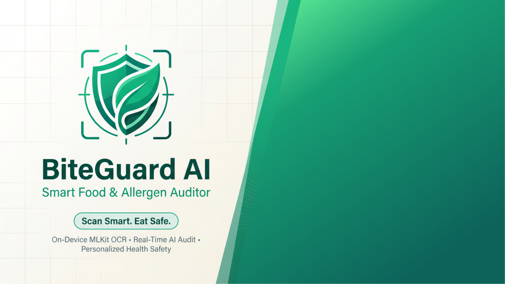
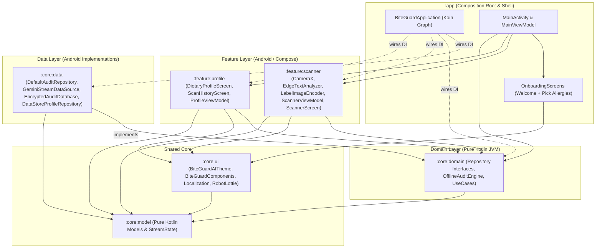

# 🛡️ BiteGuard AI — Real-Time Multimodal Allergen & Ingredient Auditor

[-216A4D?logo=android)](https://developer.android.com)
[](https://kotlinlang.org)
[-4285F4?logo=jetpackcompose)](https://developer.android.com/compose)
[](https://ai.google.dev)
[](https://developers.google.com/ml-kit)
[](https://www.zetetic.net/sqlcipher/)

<p align="center">
  
</p>

**BiteGuard AI** is a privacy-first, multimodal Android decision-support companion that helps shoppers with severe food allergies and dietary goals audit product ingredient labels in real time.

Combining **CameraX + ML Kit v2 on-device OCR**, **Google Gemini 3.8 Flash streaming multimodal reasoning** (with automated cascading fallback to `gemini-3.5-flash-lite` and `gemini-2.5-flash`), and a **100% deterministic offline chemical-derivative rule engine (`RuleBasedOfflineAuditEngine`)**, BiteGuard AI ensures you never miss hidden allergens—even in grocery store dead zones without internet connectivity.

> 📖 **Deep Dive**: For full architectural blueprints, trade-off analyses, sequence diagrams, and execution walkthroughs, check out the [Technical Documentation](.artifacts/TECHNICAL_DOCUMENTATION.md).

---

## ✨ Key Features

### 1. 🤖 Personalized 2-Step Adaptive Onboarding
- **Welcome Screen**: Adaptive Material 3 layout with a soft radial-modern animated background (`RadialModernAnimatedBackground` with draw-phase animation), interactive guardian robot Lottie animation (`robot.json`), multi-language selector (`System`, `English`, `Bahasa Indonesia`, `한국어`), and personalized user greeting across Light Mode, Dark Mode, Ultra High-Contrast mode, and varying screen sizes.
- **Pick Allergies & Dietary Goals**: One-tap configuration for the **FDA Major 9 Allergens** (Peanuts, Tree Nuts, Dairy, Gluten, Shellfish, Soy, Eggs, Fish, Sesame) and **6 Lifestyle & Clinical Health Goals** (Low Sugar, Low Sodium, Halal, Vegan, Vegetarian, Keto-Friendly), persisted reactively via Jetpack `DataStore<Preferences>`.

### 2. 📷 Uncluttered Real-Time Edge OCR Viewfinder
- **Calm Live Viewfinder + Structural Keyword Lock**: Keeps Stage 1 uncluttered with a corner focus reticle (no flickering live boxes) while ML Kit v2 detects text blocks and locks onto structural ingredient headers (`Ingredients:`, `Contains:`, `May contain:`, `Komposisi`).
- **Thermal Throttling & Memory-Safe Capture**: Automatically scales frame analysis from `30 FPS` down to eco `5 FPS` (`200ms` gate) when stationary for `> 5s`, throttles full-frame snapshot `Bitmap` decoding to avoid per-frame heap churn, and closes every `ImageProxy` deterministically in `finally`.

### 3. ⚡ 3-Stage Scanning Flow & Dedicated Audit Result Screen
- **3-Stage Scanning Flow**:
  1. `LIVE_CAMERA`: Uncluttered viewfinder with focus reticle, status HUD pill, and background ML Kit paragraph clustering.
  2. `SELECT_BLOCKS`: Freeze-frame interactive block picker where users tap highlighted bounding boxes on the frozen photo or toggle block cards before running inference.
  3. `AUDIT_RESULT`: Dedicated result screen displaying multimodal safety banners, matched chemical derivatives, highlighted OCR text, and click-to-zoom captured image inspection.
- **Live Typewriter Verdict Streaming**: Streams `SAFE`, `CAUTION`, or `DANGER` verdicts and plain-language summaries token-by-token as Gemini 3.8 Flash (with cascading fallbacks) evaluates the package.
- **Separated Filtered Words & Flagged Ingredients Card**: Isolates matched allergen derivatives (e.g., *Arachis Oil*, *Sodium Caseinate*, *Hydrolyzed Whey*, *Maltodextrin*, *Disodium Inosinate*) into high-contrast filter chips, numbered cluster pins, and expandable Material 3 Accordions (`BiteGuardAccordion`).

### 4. 🛡️ First-Token Timeout & Offline Robot Guardian Fallback
- **Configurable First-Token Timeout**: Enforces a `15,000ms` production Time-To-First-Token (`TTFT`) timeout on cloud streaming (configurable per environment/test, e.g., `5,000ms` in unit tests).
- **On-Device Chemical Derivative Matcher**: If the device is offline, the API key is unconfigured/invalid, or the network times out, BiteGuard AI automatically falls back to `OfflineAuditEngine` (`RuleBasedOfflineAuditEngine` with precompiled regex rules) and presents a reassuring Material 3 `AlertDialog` featuring the animated Guardian Robot (`robot.json`) alongside the immediate local safety verdict.

### 5. 🔒 Zero-Cloud Encrypted Audit Log & Accessibility
- **SQLCipher 256-bit AES Encryption**: Scan history and downsampled in-memory `480px` WebP package thumbnails (`thumbnail_blob`) are encrypted at rest inside `EncryptedAuditDatabase` using hardware-backed Android Keystore `AES/GCM/NoPadding` keys—never written to unencrypted disk files.
- **WCAG 2.1 AA/AAA Multimodal Signage**: Every safety badge pairs high-contrast semantic color palettes with distinct iconography (`CheckCircle`, `WarningAmber`, `Dangerous`) and explicit text labels, plus an instant **Ultra High-Contrast Accessibility Mode** toggle in the top app bar.

---

## 🏗️ Multi-Module Clean Architecture

BiteGuard AI follows **Clean Architecture** with **Dependency Inversion** and Unidirectional Data Flow (MVI / MVVM), wired with **Koin** Dependency Injection across **7 Gradle modules**:

- **Presentation (`:feature:scanner`, `:feature:profile`)** depends only on `:core:domain`, `:core:ui`, and `:core:model` — **never** on `:core:data` in production code.
- **Domain (`:core:domain`)** and **Models (`:core:model`)** are **pure Kotlin JVM** modules with zero Android framework dependencies (`Bitmap` encoding happens in `:feature:scanner` before crossing into `:core:domain`).
- **Data (`:core:data`)** depends *inward* on `:core:domain` and implements its repository interfaces (`DefaultAuditRepository`, `DataStoreProfileRepository`).
- **Composition Root (`:app`)** wires all Koin modules together (`coreDomainModule`, `coreDataModule`, `featureProfileModule`, `featureScannerModule`, `appModule`).



| Module | Type | Responsibility |
| :--- | :--- | :--- |
| `:app` | Android App | Application entry point, Koin composition root (`allBiteGuardModules`), `MainViewModel`, `MainActivity`, and 2-step adaptive onboarding flow. |
| `:feature:scanner` | Android Lib | CameraX lifecycle binding, ML Kit v2 `EdgeTextAnalyzer` with 5s thermal throttling & throttled snapshots, `LabelImageEncoder`, `ScannerViewModel`, and 3-stage `ScannerScreen`. |
| `:feature:profile` | Android Lib | Allergen & health goal configuration with M3 Accordions, chemical derivative guide, `ProfileViewModel`, and searchable/filterable encrypted scan history with bulk delete. |
| `:core:domain` | **Pure Kotlin JVM** | Platform-agnostic repository interfaces (`AuditRepository`, `ProfileRepository`), `OfflineAuditEngine` / `RuleBasedOfflineAuditEngine`, and UseCases (`AuditLabelUseCase`, `EvaluateOfflineLabelUseCase`, `SubmitAuditFeedbackUseCase`, `ExtractHighlightTermsUseCase`, `FilterScanHistoryUseCase`). |
| `:core:data` | Android Lib | `DefaultAuditRepository`, `GeminiStreamDataSource`, `DefensiveVerdictParser`, `DataStoreProfileRepository`, and `EncryptedAuditDatabase` (SQLCipher + Android Keystore). |
| `:core:ui` | Android Lib | Adaptive Light/Dark/High-Contrast Material 3 theme (`BiteGuardAITheme`), multimodal safety signage, `BiteGuardAccordion`, `RadialModernAnimatedBackground`, `ZoomableImageDialog`, localization helpers, and Lottie components (`robot.json`). |
| `:core:model` | **Pure Kotlin JVM** | Framework-free domain models (`UserDietaryProfile`, `Allergen`, `HealthGoal`, `AuditVerdict`, `FlaggedIngredient`, `TelemetryEvent`, `StreamState`). |

---

## 🚀 Getting Started

### Prerequisites
- **Android Studio** Ladybug / Meerkat or newer (AGP `9.5.2`, Kotlin `2.2.10`)
- **JDK 11+**
- **Android Device or Emulator** running API 30+ (Android 11+, `targetSdk = 37`)
- **Google AI Studio API Key** (optional — the app runs in 100% offline local-rule mode if omitted)

### 1. Configure Your Gemini API Key
Generate a free API key from [Google AI Studio](https://aistudio.google.com/app/apikey) (supports both Google AI Studio's new **`AQ.`** Authentication Keys and legacy **`AIzaSy...`** keys) and add it to your root `local.properties` file:

```properties
sdk.dir=/path/to/your/Android/Sdk
GEMINI_API_KEY=AQ.YourGoogleAiStudioAuthenticationKeyHere
```

> [!NOTE]
> BiteGuard AI uses a direct `v1beta/models/gemini-3.8-flash:streamGenerateContent?alt=sse` streaming client with automated failover (`gemini-3.8-flash` -> `gemini-3.5-flash-lite` -> `gemini-2.5-flash`) that natively supports Google AI Studio's `AQ.` Authentication Key format as well as legacy `AIzaSy...` keys. If the key is omitted or the device is offline, BiteGuard AI automatically activates its on-device rule-based allergen guardian.

### 2. Build & Run
```bash
# Assemble the debug APK
./gradlew :app:assembleDebug

# Run all unit tests across Android and pure-JVM modules (:core:domain, :core:model, :core:data, :feature:scanner, :feature:profile, :app)
./gradlew testDebugUnitTest :core:domain:test :core:model:test
```

---

## 🔍 Debugging & Logcat Diagnostics

In `debug` builds (`BuildConfig.DEBUG`), BiteGuard AI outputs structured diagnostic logs across the entire OCR and AI pipeline. Filter Logcat by **`BiteGuardAI`** to inspect:

- `BiteGuardAI_Gemini`: Model initialization (`gemini-3.8-flash`), automated fallback cascade transitions, masked API key validation, streaming token chunk counts, and network exception stacktraces.
- `BiteGuardAI_AuditRepo`: First-token latency (`ttftMs`), timeout enforcement, defensive JSON/Markdown parsing, and automatic offline fallback resolution.
- `BiteGuardAI_ScannerVM`: User intents, 3-stage flow transitions (`LIVE_CAMERA` -> `SELECT_BLOCKS` -> `AUDIT_RESULT`), and `StreamState` updates.
- `BiteGuardAI_EdgeOCR`: Real-time ML Kit text recognition latency and thermal throttling status.

---

## ⚠️ Medical Disclaimer

*BiteGuard AI is an informational decision-support tool. It does not replace professional medical advice, diagnosis, or official product package verification. Always read physical packaging carefully if you have life-threatening allergies.*
