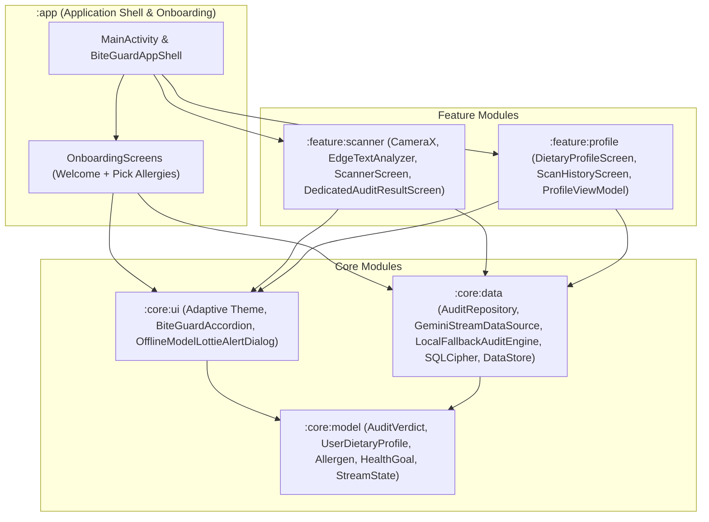

# 🛡️ BiteGuard AI — Real-Time Multimodal Allergen & Ingredient Auditor

[-216A4D?logo=android)](https://developer.android.com)
[](https://kotlinlang.org)
[-4285F4?logo=jetpackcompose)](https://developer.android.com/compose)
[](https://ai.google.dev)
[](https://developers.google.com/ml-kit)
[](https://www.zetetic.net/sqlcipher/)

**BiteGuard AI** is a privacy-first, multimodal Android decision-support companion that helps shoppers with severe food allergies and dietary goals audit product ingredient labels in real time.

Combining **CameraX + ML Kit v2 on-device OCR**, **Google Gemini 2.5 Flash streaming multimodal reasoning**, and a **100% deterministic offline chemical-derivative rule engine**, BiteGuard AI ensures you never miss hidden allergens—even in grocery store dead zones without internet connectivity.

---

## ✨ Key Features

### 1. 🤖 Personalized 2-Step Adaptive Onboarding
- **Welcome Screen**: Adaptive Material 3 layout with a soft radial-modern animated background, interactive guardian robot Lottie animation (`robot.json`), and personalized user greeting that adapts seamlessly across Light Mode, Dark Mode, Ultra High-Contrast mode, and varying screen sizes.
- **Pick Allergies & Dietary Goals**: One-tap configuration for the **FDA Major 9 Allergens** (Peanuts, Tree Nuts, Dairy/Milk, Gluten/Wheat, Soy, Eggs, Shellfish, Fish, Sesame) and **7 Lifestyle & Clinical Health Goals** (Low Sugar, Low Sodium, Vegan, Vegetarian, Halal, Keto, Low FODMAP), persisted reactively via Jetpack `DataStore<Preferences>`.

### 2. 📷 Uncluttered Real-Time Edge OCR Viewfinder
- **Live Bounding-Box Overlays**: Highlights detected text blocks on the package in real time and locks onto structural ingredient headers (`Ingredients:`, `Contains:`, `May contain:`, `Komposisi`).
- **Thermal Throttling Protection**: Automatically scales frame analysis from `30 FPS` down to an eco `5 FPS` (`200ms` gate) when the camera is stationary for more than 5 seconds, closing every `ImageProxy` deterministically on background threads.

### 3. ⚡ Dedicated Audit Result & Filtered Words Screen
- **Separated Post-Scan Experience**: Once an audit starts, the app transitions smoothly out of the live camera viewfinder into a dedicated **Label Audit Result Screen** so the camera UI never feels crowded.
- **Live Typewriter Verdict Streaming**: Streams `SAFE`, `CAUTION`, or `DANGER` verdicts and plain-language summaries token-by-token as Gemini 2.5 Flash evaluates the package.
- **Separated Filtered Words & Flagged Ingredients Card**: Clearly isolates matched allergen derivatives (e.g., *Arachis Oil*, *Sodium Caseinate*, *Hydrolyzed Whey*, *Maltodextrin*, *Disodium Inosinate*) into high-contrast filter chips and expandable Material 3 Accordions (`BiteGuardAccordion`).

### 4. 🛡️ 5-Second Timeout & Offline Robot Guardian Fallback
- **Strict 5000ms First-Token SLA**: Enforces a hard 5-second Time-To-First-Token (`TTFT`) timeout on cloud streaming.
- **On-Device Chemical Derivative Matcher**: If the device is offline, the API key is unconfigured, or the network times out, BiteGuard AI automatically falls back to `LocalFallbackAuditEngine` and presents a reassuring Material 3 `AlertDialog` featuring the animated Guardian Robot (`robot.json`) alongside the immediate local safety verdict.

### 5. 🔒 Zero-Cloud Encrypted Audit Log & Accessibility
- **SQLCipher 256-bit AES Encryption**: Scan history and downsampled in-memory `140px` WebP package thumbnails are encrypted at rest using hardware-backed Android Keystore keys—never written to unencrypted disk files.
- **WCAG 2.1 AA/AAA Multimodal Signage**: Every safety badge pairs high-contrast semantic color palettes with distinct iconography (`CheckCircle`, `WarningAmber`, `Dangerous`) and explicit text labels, plus an instant **Ultra High-Contrast Accessibility Mode** toggle in the top app bar.

---

## 🏗️ Modular Architecture

BiteGuard AI follows a clean, multi-module Unidirectional Data Flow (MVI / MVVM) architecture wired with **Koin** Dependency Injection and background coroutine dispatchers (`Dispatchers.Default` for CPU/OCR/parsing/bitmap work, `Dispatchers.IO` for DataStore/SQLCipher/network streaming):



| Module | Responsibility |
| :--- | :--- |
| `:app` | Application entry point, Koin graph initialization, 2-step adaptive onboarding flow, and top-level navigation scaffold. |
| `:feature:scanner` | CameraX lifecycle binding, ML Kit v2 `EdgeTextAnalyzer` with 5s thermal throttling, uncluttered live viewfinder, and the separated `DedicatedAuditResultScreen`. |
| `:feature:profile` | Allergen & health goal configuration with M3 Accordions, chemical derivative reference guide, and searchable/filterable encrypted scan history. |
| `:core:ui` | Adaptive Light/Dark/High-Contrast Material 3 theme (`BiteGuardAITheme`), multimodal safety signage, `BiteGuardAccordion`, `RadialModernAnimatedBackground`, and Lottie components (`robot.json`). |
| `:core:data` | `DefaultAuditRepository`, `GeminiStreamDataSource`, `DefensiveVerdictParser`, `LocalFallbackAuditEngine`, `DataStoreProfileRepository`, and `SqlCipherAuditLogDataSource`. |
| `:core:model` | Pure Kotlin domain models (`UserDietaryProfile`, `Allergen`, `HealthGoal`, `AuditVerdict`, `FlaggedIngredient`, `StreamState`). |

---

## 🚀 Getting Started

### Prerequisites
- **Android Studio** Ladybug / Meerkat or newer (AGP `9.5.2`, Kotlin `2.2.10`)
- **JDK 11+**
- **Android Device or Emulator** running API 30+ (Android 11+)
- **Google AI Studio API Key** (optional — the app runs in 100% offline local-rule mode if omitted)

### 1. Configure Your Gemini API Key
Generate a free API key from [Google AI Studio](https://aistudio.google.com/app/apikey) (supports both Google AI Studio's new **`AQ.`** Authentication Keys and legacy **`AIzaSy...`** keys) and add it to your root `local.properties` file:

```properties
sdk.dir=/path/to/your/Android/Sdk
GEMINI_API_KEY=AQ.YourGoogleAiStudioAuthenticationKeyHere
```

> [!NOTE]
> BiteGuard AI uses a direct `v1beta/models/gemini-2.5-flash:streamGenerateContent?alt=sse` streaming client that natively supports Google AI Studio's `AQ.` Authentication Key format as well as `gemini-2.5-flash` thinking/metadata payloads. If the key is omitted or the device is offline, BiteGuard AI automatically activates its on-device rule-based allergen guardian.

### 2. Build & Run
```bash
# Assemble the debug APK
./gradlew :app:assembleDebug

# Run all unit tests across :app, :core:data, :feature:scanner, and :feature:profile
./gradlew testDebugUnitTest
```

---

## 🔍 Debugging & Logcat Diagnostics

In `debug` builds, BiteGuard AI outputs structured diagnostic logs across the entire OCR and AI pipeline. Filter Logcat by **`BiteGuardAI`** to inspect:

- `BiteGuardAI_Gemini`: Model initialization (`gemini-2.5-flash`), masked API key prefix validation, streaming token chunk counts, and network exception stacktraces.
- `BiteGuardAI_AuditRepo`: First-token latency (`ttftMs`), 5000ms timeout enforcement, defensive JSON/Markdown parsing, and automatic offline fallback resolution.
- `BiteGuardAI_ScannerVM`: User intents, exponential backoff retry scheduling, and `StreamState` transitions.
- `BiteGuardAI_EdgeOCR`: Real-time ML Kit text recognition latency and thermal throttling status.

---

## ⚠️ Medical Disclaimer

*BiteGuard AI is an informational decision-support tool. It does not replace professional medical advice, diagnosis, or official product package verification. Always read physical packaging carefully if you have life-threatening allergies.*
